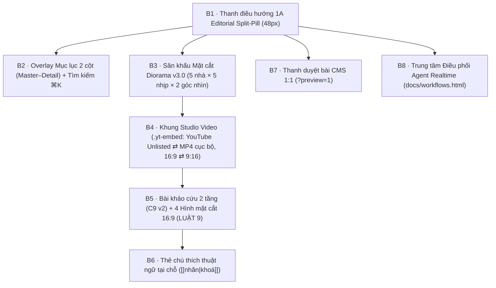

# UI-STATES — Bản đồ Bề mặt & Ma trận Trạng thái (`Where Money Sleeps`)

> Đặc tả hành vi tương tác của toàn bộ 8 bề mặt giao diện trong `docs/prototype.html` và `docs/workflows.html` để `S3 Build` và `S4 QA` nghiệm thu.

## 1. Sơ đồ 8 bề mặt giao diện

## 2. Ma trận trạng thái từng bề mặt

| Bề mặt | Trạng thái Mặc định (`Idle / Default`) | Trạng thái Tương tác (`Active / Open`) | Trạng thái Đặc biệt / Rỗng / Lỗi (`Edge / Fallback`) |
|---|---|---|---|
| **B1 · Thanh `1A Split-Pill` (`48–54px`)** | Trái: tên thương hiệu `Where Money Sleeps` (không có icon hamburger cạnh logo); Giữa: `[Danh mục k/4 ▾ │ Bài m/M: Tiêu đề ▾]` + nút `‹ ›`; Phải: `⌕ Mục lục & Tìm ⌘K` + nút `Ngôn ngữ / Ngày Đêm` | Bấm nửa trái pill ⇒ mở `B2 Overlay Mục lục` đúng danh mục đang xem; bấm nửa phải pill ⇒ mở Popover danh sách bài trong cùng danh mục (`aria-expanded="true"`) | Trên `< 680px`, thanh tự thu gọn thành **1 hàng duy nhất (`≤ 56px`, `≤ 10% dvh`)** với `flex: 1; min-width: 0` cho `#postPillBtn`, nút chạm `≥ 44×44px` trên `pointer: coarse`, tự ẩn khi cuộn xuống (`!is-open`) và `#postPop` kẹp chặt trong `[12px, vw - 12px]` |
| **B2 · Overlay Mục lục 2 cột (`Master–Detail`)** | Đóng (`hidden`, không chiếm chiều cao trang) | Mở bằng nút `Mục lục`, nửa trái `Split-Pill`, hoặc phím tắt `⌘K` / `Ctrl+K`; cột trái liệt kê 7 danh mục + tiến độ; cột phải liệt kê các chủ đề với 3 trạng thái: `Đang mở đọc` · `Chờ Duy duyệt` · `Đang biên soạn`; ô tìm kiếm lọc tức thời theo từ khoá | Khi chọn chủ đề `Đang biên soạn` (chưa có dữ liệu trong `STORIES`): hiển thị thẻ báo *"Chủ đề đang biên soạn — gõ `/vibe-post` để đúc bài"* mà không làm văng lỗi JS; bấm `Escape` hoặc nền mờ để đóng |
| **B3 · Sân khấu Mặt cắt Diorama v3.0** | Hiển thị nhịp `1/5` (`beatIdx = 0`), cửa cuốn `.shutter` mở ở các ngôi nhà trong `lit[]`, bảng tóm tắt 3 ô số (`#sum-gross`, `#sum-fee`, `#sum-net`), góc nhìn mặc định `👤 Góc nhìn Cá nhân` | Bấm nhịp `1..5` hoặc phím `← →` hoặc nút `▶ Tự chạy`: cửa cuốn đóng/mở với đường cong `cubic-bezier(0.22, 1, 0.36, 1)`, thông điệp chạy trên cao, hạt tiền chạy dưới ngầm, số tiền nội suy mượt qua `animateMoneyText()`; gạt sang `⚙️ Sổ kế toán (TT 99/2025)` ⇒ mở bảng bút toán kép `Nợ / Có` | Ở nhịp chưa phát sinh bút toán kế toán: khay `Sổ kế toán` hiện rõ *"Đoạn này mới có lời hứa / tin báo, chưa phát sinh bút toán ghi sổ hoặc dòng tiền quyết toán"* |
| **B4 · Khung Studio Video (`.yt-embed`)** | Nằm đầu bài khảo cứu và trong tab `C · Studio Kịch bản Video`; mặc định mở định dạng `YouTube Dài 16:9 (8–10 phút)` kèm danh sách nút nhảy chương (`Chapters`) | Chuyển đổi `YouTube Dài 16:9` ⇄ `Shorts 9:16`; bấm vào bất kỳ mốc thời gian chương nào (`00:42`, `02:15`...) ⇒ tua ngay video tới đúng giây đó (`currentTime = sec`) và tự phát | **Fallback hai tầng (`QĐ 56`):** Khi `embedStatus === "uploaded_unlisted"` hoặc `"uploaded_public"` có `youtubeId` 11 ký tự hợp lệ ⇒ nhúng `youtube-nocookie.com/embed/`; khi đang `pending_upload` (chờ YouTube duyệt hạn mức API) ⇒ tự động phát file `.mp4` 30fps cục bộ từ `../dist/youtube/<story>-{long-16x9,short-9x16}.mp4` |
| **B5 · Bài khảo cứu 2 tầng & 4 Hình `16:9` (`LUẬT 9`)** | Tab `A · Bài khảo cứu toàn cảnh` mở mặc định: Chương 01 thuần chữ có `drop-cap`; Chương 02–05 đan xen 4 hình mặt cắt `16:9` (`1200×675`) ngay sau đoạn 1 kèm chú thích 3 tầng; kèm sơ đồ 3 kênh, hộp *Có lợi / Thành bẫy* và câu hỏi tự soi | Bấm nút `↗ Xem trên Mặt cắt Diorama · Nhịp k/5` trong chú thích hình `<figcaption>` ⇒ cuộn mượt lên `#stage` và kích hoạt đúng nhịp `beatIdx` tương ứng; chuyển sang Tab `B · Phân tích chuyên sâu & Kế toán TT 99/2025` để đọc 4 cơ chế, toán `IRR/EIR`, chuỗi bút toán và ngoại lệ | Hình ảnh khai báo cứng `width="1200" height="675"` + `aspect-ratio: 16/9` nên ngay cả khi mạng chậm vẫn giữ đúng khung (`CLS = 0`) |
| **B6 · Thẻ chú thích thuật ngữ (`[[nhãn\|khoá]]`)** | Từ chuyên ngành gạch chân nét đứt nhẹ trong dòng văn bản | Chạm/click vào thuật ngữ ⇒ mở khay giải nghĩa tiếng Việt bình dân + ví dụ thực tế + gốc thuật ngữ tiếng Anh ngay tại chỗ | Nếu bấm sang thuật ngữ khác hoặc bấm nút đóng `×`: cập nhật nội dung khay mượt mà không làm nhảy vị trí đọc |
| **B7 · Thanh duyệt CMS 1:1 (`?preview=1`)** | Ẩn ở chế độ người đọc thường (`previewMode = false`), chỉ hiện các bài `published` | Khi bật `Chế độ duyệt bài` (hoặc `?preview=1`): hiện thanh nổi ở đáy màn hình với bộ lọc `Tất cả / Chờ Duy duyệt / Đã đăng`, 5 đèn cổng kiểm (`C1–C5`, `C6 TT99`, `C9 v2`, `F1–F4`, `B1–B4`), nút `Sửa chữ trực tiếp` (`contenteditable`) và nút `Duyệt & Đăng` | Bài ở trạng thái `review` hoặc `demo-prototype` luôn hiển thị nhãn cảnh báo rõ ràng trên thanh duyệt để không nhầm với bài đã được Duy ký thật |
| **B8 · Trung tâm Điều phối Agent (`docs/workflows.html`)** | Mở quy trình 1 (`/vibe-post` 6 bước), hiển thị sơ đồ phân cấp có hạt xung `<circle class="signal-orb">` chạy dọc dây nối và thẻ thông tin nhà cung cấp/model ở cột phải | Bấm `▶ Chạy mô phỏng Realtime`, chọn 1 trong 5 quy trình, lọc theo 6 trụ cột nhà cung cấp (`Claude`, `Gemini`, `ElevenLabs`, `Veo + FFmpeg`, `YouTube API`, `Python T0`), hoặc kéo 4 thanh trượt chấm điểm `S = 0..8` để xem kết quả định tuyến `T0..T4` tức thời | Gọi `window.__vibeSeek(stepIdx)` trong DevTools nhảy thẳng tới bước bất kỳ để chụp kiểm tra |

## 3. Chưa xác minh được

- Tốc độ giải mã video `.mp4` cục bộ (~50 MB) khi mở trực tiếp qua giao thức `file://` trên trình duyệt di động đời cũ (trên môi trường web chuẩn có HTTP Range Requests thì phát tức thời).
- Cross-vendor model review (Claude ↔ Gemini) — no human external verifier ran.
